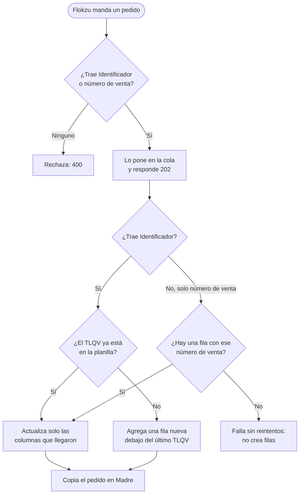

# Spreadsheet API

Microservicio interno de **Tienda Lo Quiero Acá** que lee y escribe las planillas de Google Sheets de la operación.

Recibe los pedidos (TLQV) que manda Flokzu y los carga en la planilla de pedidos: si el pedido ya está, actualiza las columnas que llegaron; si no está, agrega una fila. Cada cambio se copia también a Madre. Además, deja leer otras planillas —la de lectura para facturación, Stock BUE y Costos Operaciones— para que otros servicios no tengan que hablar con Google.

## Qué hace

| | |
|---|---|
| **Carga de pedidos** | Agrega o actualiza la fila de un TLQV en la planilla de pedidos, de a un pedido por vez y en orden. |
| **Actualización por número de venta** | Actualiza un pedido existente buscándolo por su número de venta de Mercado Libre. Nunca crea filas nuevas por esta vía. |
| **Columnas protegidas** | No pisa las columnas que se calculan o se cargan a mano en la planilla, aunque el pedido las traiga. |
| **Copia en Madre** | Cada pedido cargado se copia a la tabla de control de Madre. |
| **Lecturas** | Devuelve filas de las planillas de lectura (solapas TLQV y MADRE), de Stock BUE y de Costos Operaciones, por página o por TLQV. |

## Cómo funciona



El detalle de cada paso está en la [guía funcional](docs/funcional.md).

## Ambientes

| Ambiente | URL base |
|---|---|
| Producción | `https://spreadsheet.loquieroaca.com` |
| Local | `http://localhost:3000` |

Además de los endpoints, el servicio publica dos herramientas:

| Herramienta | Ruta | Para qué |
|---|---|---|
| Documentación | `/docs` | Esta documentación, navegable y con buscador. |
| Bull Board | `/admin/queues` | Ver la cola de pedidos: qué espera, qué se procesó y qué falló. Pide usuario y clave. |

## Autenticación

**Los endpoints no piden ninguna clave.** Cualquiera que llegue a la URL puede leer las planillas y cargar pedidos. Si el servicio está protegido, es por fuera de este código (red o proxy). Ver [limitaciones conocidas](docs/tecnico.md#limitaciones-conocidas).

## Primer llamado

Leer un TLQV de la solapa TLQV de la planilla de lectura no cambia nada y sirve para comprobar que el servicio llega a Google:

```bash
curl -s "https://spreadsheet.loquieroaca.com/sheet/prueba-lectura/TLQV/TLQV-1569"
```

Cargar o actualizar un pedido, igual que lo hace Flokzu:

```bash
curl -s -X POST "https://spreadsheet.loquieroaca.com/sheet/orders" \
  --data-urlencode 'Identificador=TLQV-12938' \
  --data-urlencode 'ESTADO=COMPRADA'
```

Este segundo llamado **escribe en la planilla de pedidos y en Madre**. No hay modo de prueba.

## Documentación

**Pedidos y planillas**

| Documento | Qué explica |
|---|---|
| [Guía funcional](docs/funcional.md) | Qué planillas usa, cómo se carga un pedido, columnas protegidas, pedidos históricos, números, copia en Madre y lecturas. |
| [Errores](docs/errores.md) | Por qué un pedido no se carga o una lectura falla, qué significa cada mensaje y qué hacer. |

**API**

| Documento | Qué explica |
|---|---|
| [Referencia de la API](docs/api.md) | Todos los endpoints: carga de pedidos, escritura genérica y lecturas, con ejemplos. |

**Técnico**

| Documento | Qué explica |
|---|---|
| [Arquitectura y configuración](docs/tecnico.md) | Capas del código, integraciones, la cola, reintentos, cachés, variables de entorno, scripts y tests. |
| [Operación](docs/operacion.md) | Deploy, verificación, y qué hacer ante los problemas más frecuentes. |

## Desarrollo local

Requisitos: Node.js 20 o superior, un Redis accesible y una service account de Google con acceso a las planillas.

```bash
npm install
cp .env.example .env    # completar credenciales e IDs de planilla
npm run start:dev       # http://localhost:3000
```

```bash
npm test                # tests unitarios
npm run lint            # eslint
npm run typecheck       # chequeo de tipos
```

Para ver la documentación como sitio, sin levantar Redis, Google ni el resto del servicio:

```bash
npm run docs:preview    # http://localhost:4310/docs
```

## Stack

NestJS 10 · TypeScript · Google Sheets API (googleapis) · BullMQ sobre Redis · Jest.
